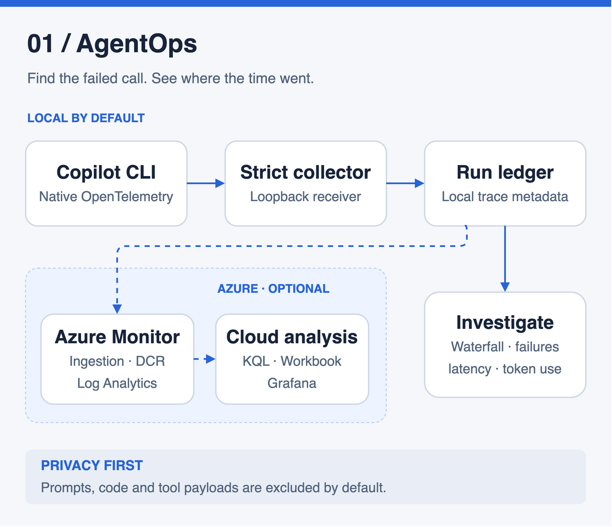
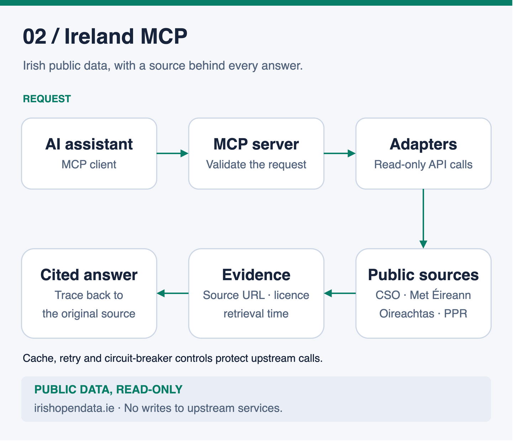
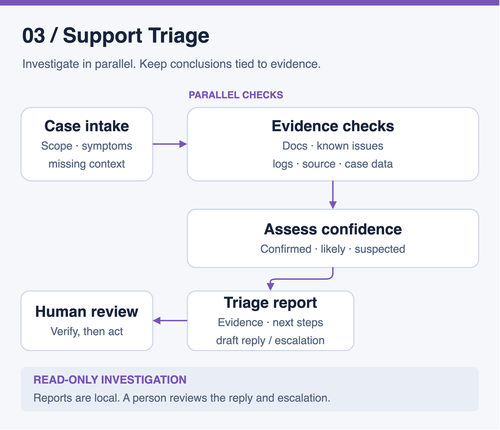

# Conor Mongan

I investigate difficult systems problems, explain them clearly, and build tools that make the next incident easier to solve.

Member of Technical Staff at **Microsoft** · previously Technical Support Engineer II at **Datadog** · Dublin, Ireland

My work connects customer engineering, observability and practical AI: understand the problem, follow the evidence, and make the result useful to the next person.

## Agents, data and diagnosis

Select a diagram to open the full-size image.

### Copilot CLI AgentOps for Azure

Find the failed or slow tool call in a Copilot CLI run. Inspect a local trace waterfall, failure details, latency and token use. Azure Monitor is optional; prompts, code and tool payloads are excluded by default.

<a href="assets/diagrams/agentops-light.png">
  <picture>
    <source media="(prefers-color-scheme: dark)" srcset="assets/diagrams/agentops-dark.png">
    
  </picture>
</a>

[Repository](https://github.com/c-mongan/copilot-cli-agentops-azure) · [Demo and evidence](https://github.com/c-mongan/copilot-cli-agentops-azure#readme) · [Architecture](https://github.com/c-mongan/copilot-cli-agentops-azure/blob/main/docs/architecture.md) · [Editable diagram](assets/diagrams/agentops.drawio)

Development preview. Cost figures are estimates, not billed costs. The quick demo uses generated sample data.

### Ireland MCP

Ask an AI assistant about Irish public data and get a response with source citations. A read-only MCP server connects public APIs to tools such as search, fetch and nearby queries.

<a href="assets/diagrams/ireland-mcp-light.png">
  <picture>
    <source media="(prefers-color-scheme: dark)" srcset="assets/diagrams/ireland-mcp-dark.png">
    
  </picture>
</a>

[Repository](https://github.com/c-mongan/ireland-mcp) · [Live website](https://irishopendata.ie) · [Architecture and request flow](https://github.com/c-mongan/ireland-mcp#readme) · [Editable diagram](assets/diagrams/ireland-mcp.drawio)

Source coverage and availability are documented in the repository. The server does not write to upstream services.

### Support Triage Agent

Turn a support case into an evidence-graded investigation. Check documentation, known issues, logs and source history in parallel, then produce a report and draft response for a support engineer to review.

<a href="assets/diagrams/support-triage-light.png">
  <picture>
    <source media="(prefers-color-scheme: dark)" srcset="assets/diagrams/support-triage-dark.png">
    
  </picture>
</a>

[Repository](https://github.com/c-mongan/support-triage-agent-template) · [Recorded demo](https://github.com/c-mongan/support-triage-agent-template/tree/main/docs/demo) · [Architecture](https://github.com/c-mongan/support-triage-agent-template/blob/main/docs/architecture.md) · [Editable diagram](assets/diagrams/support-triage.drawio)

Read-only investigation template. Sample cases are synthetic; this is not an official integration with an employer or customer.

## Visual and voice projects

### Effects Atlas

40 React effects and practical website recipes. Explore a visual gallery, adjust an example, and download a working starter. Includes motion controls, source credits and browser fallbacks.

[Live gallery](https://c-mongan.github.io/effects-atlas/) · [Storybook](https://c-mongan.github.io/effects-atlas/storybook/) · [Repository](https://github.com/c-mongan/effects-atlas)

### Voicebox Studio / LiveKit Voice Studio

A voice conversation app with local speech recognition and generation. Choose local or cloud reasoning, and explore interruption, recovery and the LiveKit pipeline.

[Repository](https://github.com/c-mongan/livekit-voice-studio) · [Demo](https://github.com/c-mongan/livekit-voice-studio/blob/main/docs/demo.md) · [Local and cloud options](https://github.com/c-mongan/livekit-voice-studio/blob/main/docs/local-cloud-components.md)

Single-user development preview, tested on Apple Silicon. Cloud providers receive the data needed for their selected component.

### Narrated Deck Studio

Turn source material into reviewed presentations, narrated videos and captions through a local studio. Separate review stages keep the plan, slides, voice and release under human control.

[Repository](https://github.com/c-mongan/narrated-deck-studio) · [Architecture](https://github.com/c-mongan/narrated-deck-studio/blob/main/docs/ARCHITECTURE.md) · [Acceptance checks](https://github.com/c-mongan/narrated-deck-studio/blob/main/docs/ACCEPTANCE.md)

In development. Package signing, clean-host installation, native PowerPoint playback and dependency security checks remain release gates.

## Tools and contact

**Observability:** OpenTelemetry, Azure Monitor, KQL, Datadog

**Build:** TypeScript, Python, Azure Functions, GitHub Actions, MCP and Agent Skills

[Agent Systems Field Guide](https://github.com/c-mongan/agent-systems-field-guide) · [Safe Storage Optimizer](https://github.com/c-mongan/safe-storage-optimizer) · [LinkedIn](https://www.linkedin.com/in/conor-mongan/)

These are independent personal projects. Diagrams show the public project architecture, not employer systems.
